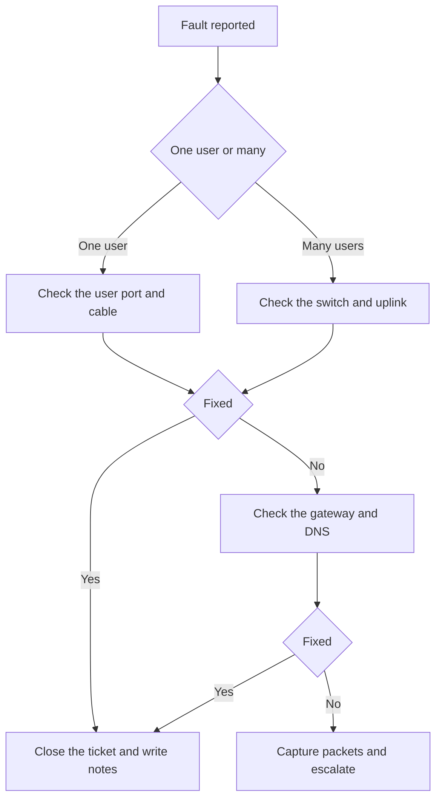

# Network Troubleshooting Playbook

Status - Hands-on lab experience, based on professional work. The runbooks below come from faults I have worked on in live enterprise networks. Work the steps in order, write down what you find at each step, and raise the ticket to L2 or L3 when the steps run out.

## Objective

Give every common network fault a clear set of steps, so the same problem gets fixed the same way every time. Each runbook lists the symptoms, the checks in order, and the point where you escalate. Fix things inside the SLA, and keep the user posted while you work.

## Triage flow

## Runbook 1 - Connection drops

### Symptoms

- A user loses the network for a few seconds or minutes, then it comes back
- The drop hits one user, one floor, or one switch at a time

### Checks

1. Ask the user if the cable is loose, and check the link light on the switch port
2. Run show interfaces status and look for a port that flaps between up and down
3. Run show interfaces and look for input errors, CRC errors, or collisions on the port
4. Swap the patch cable, and try a known good port on the same switch
5. Check the port config, and confirm the port sits in the right VLAN with the right mode
6. Look at the switch logs for the time of the drop, and check for spanning tree changes

### Escalate when

- The port keeps flapping after a cable and port swap
- More than one switch shows the same fault at the same time
- The logs point at a fault on an uplink or a core device

## Runbook 2 - Internet drops

### Symptoms

- Users can reach inside servers but not the internet
- The drop hits everyone at a site at once

### Checks

1. Ping the LAN gateway from a user machine, then ping the WAN address on the edge router
2. Ping 8.8.8.8 from the router, then ping a name like google.com to test DNS as well
3. Run show ip interface brief on the edge router and check the WAN link is up
4. Run show ip nat translations and check inside hosts are getting translated
5. Run show ip route and check the default route points at the provider
6. Check the ACL on the outside interface and confirm it is not blocking the traffic

### Escalate when

- The WAN link is down and the provider has to be called
- NAT translations stop building even though the link is up
- The default route is missing and will not come back after a check of the config

## Runbook 3 - IP conflicts

### Symptoms

- A user gets a Windows warning that an IP address is already in use
- The fault moves from one machine to another

### Checks

1. Note the IP address from the warning, and find which machine should hold it
2. Run show ip dhcp binding on the DHCP server or router, and check who holds the lease
3. Run arp -a on the affected machine and look for two MAC addresses on the one IP
4. Check for a device with a static IP set inside the DHCP pool range
5. Free the clash by moving the static device out of the pool range, or by reserving its address in DHCP
6. Ask the user to release and renew, then confirm the warning is gone

### Escalate when

- The clash comes back after the fix
- A rogue DHCP server is handing out addresses on the network
- The pool is full and more addresses are needed

## Runbook 4 - Slow links and performance bottlenecks

### Symptoms

- File copies crawl, video calls break up, and pages load slowly
- The problem is worst at busy times of the day

### Checks

1. Run a ping to the LAN gateway and look for high or jumping response times
2. Run show interfaces and look for output drops, input errors, or a link running at full speed
3. Run show processes cpu on the router or switch and check for high CPU
4. Capture traffic with Wireshark and look for retransmissions and duplicate Acks
5. Check the bandwidth use on the link, and see if one host or one app is taking most of it
6. Check for duplex mismatch, and confirm both ends of the link agree on speed and duplex

### Escalate when

- The link is full and needs more bandwidth
- CPU stays high even after the top talkers are found
- The fault sits on a provider link and needs their help

## Runbook 5 - DNS failure

### Symptoms

- Users can ping an IP address but cannot open any website by name
- The fault hits everyone at a site at once, or one user only

### Checks

1. Ping 8.8.8.8 from the affected machine to confirm the network path works
2. Run nslookup google.com and see if a DNS server answers
3. Check which DNS server the machine is using, and compare it with a working machine
4. Run nslookup google.com 8.8.8.8 to test a public DNS server directly
5. Check the DHCP scope and confirm it hands out the right DNS servers
6. Capture DNS traffic with Wireshark and look for queries with no response

### Escalate when

- The DNS server is down and needs a restart or a rebuild
- The fault sits on a provider DNS service
- DNS works for some names and fails for others, which points at a record problem

## Runbook 6 - OSPF neighbor down

### Symptoms

- One site loses routes to another site
- The OSPF neighbor shows as down or stuck in a state below Full

### Checks

1. Run show ip ospf neighbor and note the state of the missing neighbor
2. Ping the neighbor address to confirm the link is up
3. Run show ip ospf interface and check the hello and dead timers match on both sides
4. Check the area number matches on both sides of the link
5. Check the MTU on both interfaces, since a mismatch stops the adjacency in ExStart
6. Check for duplicate router IDs on the segment
7. Run debug ip ospf hello for a short time and read what it shows

### Escalate when

- The link is up but the adjacency will not form after the timer, area, and MTU checks
- More than one neighbor drops at the same time
- The fault points at a core router or a provider link

## Runbook 7 - VRRP failover check

### Symptoms

- Users lose the gateway for a short time, then it comes back
- The VRRP master and backup keep swapping roles

### Checks

1. Run show vrrp brief on both routers and note which one is master
2. Check the priority on both routers, and confirm the master has the higher priority
3. Check the virtual IP matches on both routers
4. Check the tracked interface or object, and confirm it is up on the master
5. Look for flapping on the tracked interface in the logs
6. Shut the master link in a lab first, then watch the backup take over

### Escalate when

- Both routers claim to be master at the same time
- The backup never takes over when the master goes down
- The roles swap again and again with no clear cause

## Runbook 8 - VLAN misconfiguration

### Symptoms

- A user cannot reach anything, but the link light is on
- A user lands in the wrong VLAN and reaches the wrong servers

### Checks

1. Run show vlan brief on the switch and find which VLAN the port sits in
2. Run show interfaces switchport and check the mode and the VLAN on the port
3. Check the trunk ports on the path and confirm the VLAN is allowed on each trunk
4. Check the native VLAN matches on both ends of every trunk
5. Ping the gateway for the right VLAN from the affected machine
6. Check the DHCP scope for that VLAN and confirm it hands out addresses

### Escalate when

- The VLAN is missing from a core switch and needs to be created there
- The fault spans more than one switch
- The native VLAN mismatch points at a config change on a trunk

## Escalation matrix

- L1, work the runbook steps, fix what you can, and write down what you found
- L2, the fault needs deeper config work or a change on a core device
- L3, the fault needs design work, a vendor case, or a change to the network architecture
- Provider, the fault sits on a WAN or internet link and only the provider can fix it

## Ticket template

- Title, one line that says the fault and the site
- Affected users, how many and where they sit
- Start time, when the fault first showed up
- Symptoms, what the users see
- Checks run, each step and what it showed
- Fix applied, what you changed and when
- Result, fixed or escalated, and who has it now
- Follow up, what to watch for after the fix

## Ticket notes

- Log every fault in ServiceNow or Jira as an Incident, and use a Request Item (RITM) when a user asks for a change
- Write what you checked, what you found, and what you changed, in plain words
- Note the start time and the fix time, so the SLA can be measured
- If you escalate, say which steps you already ran, so the next team does not repeat them

## Learning outcomes

- Work a fault from symptoms to fix without guessing
- Know which command answers which question
- Spot when a fault is bigger than one user and escalate early
- Write a ticket that the next engineer can pick up and finish
- Build a runbook for a new fault the first time you see it

## Screenshot placeholders

- screenshots/triage-flow.png - Placeholder, add a screenshot of the triage flow in use
- screenshots/ticket-example.png - Placeholder, add a screenshot of a well written ticket with names and addresses removed

## Project status

Hands-on lab experience, based on professional work. Runbooks 1 to 4 come from real faults worked on live networks. Runbooks 5 to 8 are written from the same troubleshooting method and are practised in the lab.
